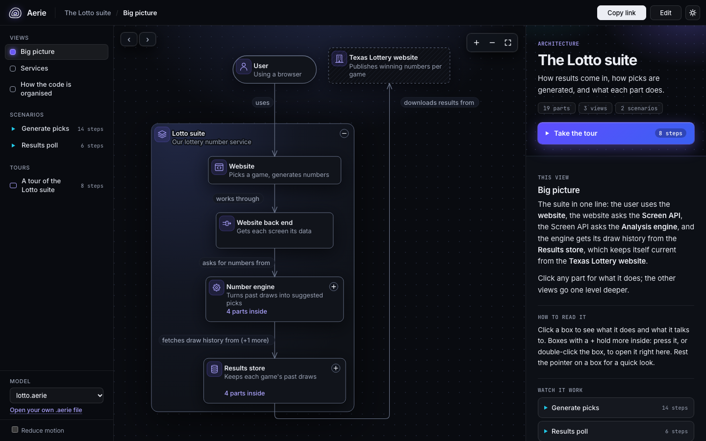

# Aerie Diagrams

**One model. Every audience.**

Aerie is diagram-as-code for architecture. Engineers describe a system once, in a plain text file, and
every reader explores it as an interactive diagram at their own level: the same model reads differently
for an executive, a manager and an engineer, and opens deeper in place when someone wants more detail.

The Lines language, the interactive viewer in the Signal look (dark, with a
light theme), plain wording first with "More technical" on demand, scenarios and presenter mode, the live editor and watch mode, the Aerie skill for Claude, and drift
detection, which checks a model against the code it describes, on the command line and on every pull
request ([CHANGELOG.md](CHANGELOG.md)).



## Quick start

Requires Node.js 24 (see `.nvmrc`).

### Install

```sh
npm ci
npx playwright install chromium   # only needed to run the browser tests
```

### See a diagram

```sh
npm run dev
```

Open the address it prints. It shows [the Lotto sample](samples/lotto.aerie), Aerie's flagship
model of a real lottery number service. Everyone starts with the plainest wording. Click a box to
read about it in the side panel, and press "More technical" there to uncover how a manager or an
engineer would put it, or rest the pointer on a box for a quick look; "Word the whole diagram for
Engineer" (or the keys 1, 2 and 3) changes every word on the page, and nothing moves. Use a box's
round button to open it in place. Choose a scenario to play it on the diagram (arrow keys to step,
Space to play, Esc to end), or "Take the tour" to present it full screen. The sun button in the top
bar switches to the light theme for bright rooms and projectors. The address always holds what you see, so "Copy
link" shares the exact picture. "Edit" opens the live split editor beside the diagram; you can
also open a local `.aerie` file from the sidebar.

### Find a part and follow it

Press **Find element**, **Ctrl+K**, or **Command+K** to search the whole model by id, names
in any audience, tags, or code references. Results show the containment path in your current
wording. Use Up and Down to move through them, Enter to choose, and Escape to close. Choosing a
result opens the containers around it and brings it into view, switching to an eligible view
when necessary.

A selected element's details list **See this element in**. Choose one of those views to keep
that exact element selected, with the same audience wording. Back and Forward restore the
pictures you visited. Choosing a view from the ordinary sidebar still opens its default picture.

### Export a static PNG or PDF

Choose **Export** to preview the current view with all nested containers open. Pick a scenario,
wording and PNG or PDF, and optionally include the model's full component reference. Every stage
and detailed scenario step is included. The document adds no application branding, and export
settings leave your reading picture unchanged.

PNG is one image; PDF paginates long explanations and reference material. PDF pages preserve the
preview as images, so their text is not selectable. Oversized PNGs offer PDF rather than cropping
content. Invalid edits can export the last valid model with a warning outside the file. Files are
prepared locally. Confluence Cloud is the target; a live import into a Cloud instance has not been
verified. Supported limits and behavior are in [the export specification](docs/spec/export.md).

### Share an interactive HTML file

Press **Export HTML** to download the current model as one interactive file. Move it to another
folder or send it to a reader, who can open it in a browser without a server or network connection.
The file opens on your current picture and theme and contains the complete Lines source, every
view, and every audience's wording, including parts that are initially closed or outside the
opening view. Search, following, scenarios, tours, and audience changes remain available; the
portable reader has no editor or model picker.

An export is a snapshot. Later source changes do not update it. Fix any model errors before
exporting. For a local model, **Share model** still offers its `.aerie` file; a picture link alone
does not include that source.

### Add documentation beside the picture

Descriptions support paragraphs, bold, emphasis, inline code, links, headings, flat lists, and
fenced code blocks. Write each heading, list item, or code-block line as its own `>` line;
deeper-indented continuation lines still join with spaces. Audience replacements and added
technical paragraphs work as before.

```aerie
api: Orders API [service]
  > # Ownership
  > Maintained by **Platform**. [Contact the owner](mailto:platform@example.com).
  > ## Runbooks and decisions
  > - [Diagnose failures](https://example.com/runbooks/orders)
  > - [Read the architecture decision](https://example.com/decisions/orders)
```

These are authored explanations. Existing `code` lines appear as code references in the same
details panel; they do not claim that a drift check passed. Authored HTML stays literal, and
executable links are inactive. Use absolute web links when exported-file recipients will not
have repository documents beside the file. See [reader tools](docs/spec/reader-tools.md).

### Write a model and watch it

Write a `.aerie` file in your own editor, and see its diagram update on every save:

```sh
npm run build                     # once: watch mode serves the built page
npx aerie watch path/to/model.aerie
```

The page keeps the last good picture while the file has errors, and lists them in plain words.
Outside this checkout, run `node <checkout>/src/cli/aerie.ts watch <file>` instead: `npx aerie`
elsewhere would fetch an unrelated package of the same name.

### Check and format

```sh
npx aerie check samples/lotto.aerie     # every problem, with line, column and advice
npx aerie format samples/lotto.aerie    # tidies spacing, never meaning
npx aerie model samples/lotto.aerie     # the canonical JSON model
```

The language is described in [docs/spec/language.md](docs/spec/language.md).

### Check a model against its code

`aerie drift` reads the project's files (Docker Compose, Maven with Spring Boot and Java, Node with
Angular; it never runs anything), compares what it finds with the model, and reports each
difference in plain words, with its evidence in the code, a suggested Lines edit, and the ignore
line to use if the difference is meant. Aerie never writes the model.

```sh
npx aerie drift docs/architecture.aerie                # where the diagram and the code differ
npx aerie drift docs/architecture.aerie --format diff  # every suggested edit, as a patch
```

A model needs nothing extra to be checked: elements are matched to the code by name. Three kinds of
line make the check exact without changing the drawing:

```aerie
model shop: Corner shop

system
  repo .
  repo ../shop-web
  compose deploy/compose.yaml

shop: Shop [system]
  web: Storefront [service]
    code compose:web npm:shop-web
  api: Orders API [service]
    code compose:api maven:orders-api

web sends orders to api

ignore drift maven:orders-legacy - retiring with the old admin app
```

- The **system root** (`system`) names the repos that form the system, from the model file's folder,
  and the Compose files that are the truth.
- A **code line** (`code`) under an element names the code it stands for: `compose:<service>`,
  `maven:<artifactId>`, `npm:<package name>`, or `class:<com.pkg>.*` for a part of a Java module.
- An **ignore line** (`ignore drift <subject> - <reason>`) marks a difference as meant, with a
  reason that is reviewed like any other line. One that excuses nothing any more is reported.

Findings are **drift** (several techniques agree, or an exact check fails, such as a code line naming
code that is gone) or **likely** (one technique); only drift fails by default (`--fail-on likely` is
stricter). What code cannot show, such as a person using a website, is listed as not checked.

On GitHub, this repository is also an Action that checks every pull request: it posts one comment
per model file (edited in place on each run), suggests edits on the lines the pull request adds,
and fails the check on drift.

```yaml
on: pull_request
permissions:
  contents: read
  pull-requests: write
jobs:
  drift:
    runs-on: ubuntu-24.04
    steps:
      - uses: actions/checkout@v7
      - uses: Brizton-Floyd/aerie-diagrams@main # or a commit SHA
        with:
          models: docs/architecture.aerie # one or more, one per line
          # fail-on: likely               # fail on likely findings too
          # repos-token: ${{ secrets.AERIE_REPOS_TOKEN }} # reads private sibling repos
```

A model whose system root names other repos (`repo ../lotto-options-core`) gets each checked out
beside the repository, read only, from the repository of that folder's name under the same owner
(the `repos` input names others). Any other CI runs the command and uses its exit code (0 no
drift, 1 drift, 2 drift cannot run):

```sh
npx aerie drift docs/architecture.aerie --format json > drift.json
```

Drift is described in [docs/spec/drift.md](docs/spec/drift.md), the Action in its section 8.

### Let Claude write the model

[skills/aerie/](skills/aerie/SKILL.md) is a skill for Claude: it reads a project, writes its model
in Lines with wording for each audience, ties it to the code with a system root and code lines, and
runs `aerie check` and then `aerie drift` until the file is clean. When Claude later changes code in
a way that changes the architecture, the skill runs drift and updates the model in the same change.
Copy the folder into `~/.claude/skills/aerie/` (every project) or `.claude/skills/aerie/` (one
project), then ask Claude to "describe this system as an Aerie diagram". The Lotto sample was
refined this way; [samples/lotto.md](samples/lotto.md) records how.

### Run the checks

```sh
npm run check
```

`npm run check` is the single gate: type check, lint (including the docs and coverage checks),
unit tests, layout rule checks and readability scores, goldens, screenshots and browser journeys.
CI runs the same command on every push and pull request.

## Where to look

- [AGENTS.md](AGENTS.md) - how to work here, including the clean-room rules (mandatory).
- [GLOSSARY.md](GLOSSARY.md) - the product's own vocabulary.
- [docs/spec/](docs/spec/overview.md) - the functional specification: v1 behavior and post-v1 additions.
- [docs/decisions/](docs/decisions/) - settled product decisions.
- [docs/slice-plan.md](docs/slice-plan.md) - the order in which v1 is built.

## Licence

All rights reserved. See [LICENSE](LICENSE).
