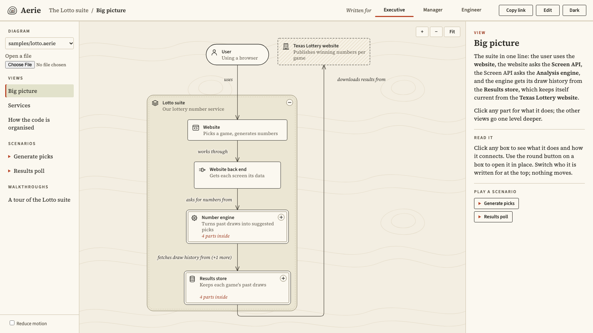

# Aerie Diagrams

**One model. Every audience.**

Aerie is diagram-as-code for architecture. Engineers describe a system once, in a plain text file, and
every reader explores it as an interactive diagram at their own level: the same model reads differently
for an executive, a manager and an engineer, and opens deeper in place when someone wants more detail.

Private. Version 1.0.0 is complete: the Lines language, the interactive viewer with its audience
switch, scenarios and presenter mode, the live editor and watch mode, and the Aerie skill for Claude
([CHANGELOG.md](CHANGELOG.md)).



## Quick start

Requires Node.js 24 (see `.nvmrc`).

### Install

```sh
npm ci
npx playwright install chromium   # only needed to run the browser tests
```

### See a diagram

```sh
npm run dev
```

Open the address it prints. It shows [the Lotto sample](samples/lotto.aerie), Aerie's flagship
model of a real lottery number service. Pick a view in the sidebar and an audience at the top
(or press 1, 2 or 3): the words change for an executive, a manager or an engineer, and nothing
moves. Click a box to read about it in the side panel, and use its round button to open it in
place. Choose a scenario to play it on the diagram (arrow keys to step, Space to play, Esc to end),
or the walkthrough to present it full screen. The address always holds what you see, so "Copy
link" shares the exact picture. "Edit" opens the live split editor beside the diagram; you can
also open a local `.aerie` file from the sidebar.

### Write a model and watch it

Write a `.aerie` file in your own editor, and see its diagram update on every save:

```sh
npm run build                     # once: watch mode serves the built page
npx aerie watch path/to/model.aerie
```

The page keeps the last good picture while the file has errors, and lists them in plain words.
Outside this checkout, run `node <checkout>/src/cli/aerie.ts watch <file>` instead: `npx aerie`
elsewhere would fetch an unrelated package of the same name.

### Check and format

```sh
npx aerie check samples/lotto.aerie     # every problem, with line, column and advice
npx aerie format samples/lotto.aerie    # tidies spacing, never meaning
npx aerie model samples/lotto.aerie     # the canonical JSON model
```

The language is described in [docs/spec/language.md](docs/spec/language.md).

### Let Claude write the model

[skills/aerie/](skills/aerie/SKILL.md) is a skill for Claude: it reads a project, writes its model
in Lines with wording for each audience, and runs `aerie check` until the file is clean. Copy the
folder into `~/.claude/skills/aerie/` (every project) or `.claude/skills/aerie/` (one project),
then ask Claude to "describe this system as an Aerie diagram". The Lotto sample was refined this
way; [samples/lotto.md](samples/lotto.md) records how.

### Run the checks

```sh
npm run check
```

`npm run check` is the single gate: type check, lint (including the docs and coverage checks),
unit tests, layout rule checks and readability scores, goldens, screenshots and browser journeys.
CI runs the same command on every push and pull request.

## Where to look

- [AGENTS.md](AGENTS.md) - how to work here, including the clean-room rules (mandatory).
- [GLOSSARY.md](GLOSSARY.md) - the product's own vocabulary.
- [docs/spec/](docs/spec/overview.md) - the functional specification: what Aerie v1 does.
- [docs/decisions/](docs/decisions/) - settled product decisions.
- [docs/slice-plan.md](docs/slice-plan.md) - the order in which v1 is built.

## Licence

All rights reserved. See [LICENSE](LICENSE).
